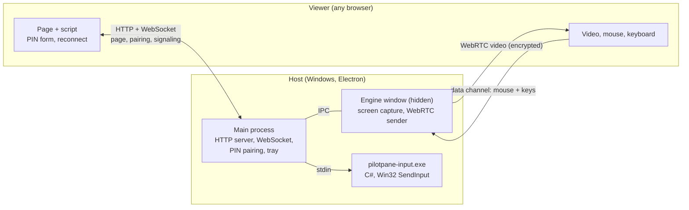

# PilotPane

**Control your Windows laptop from any device with a browser on your local network.**

PilotPane turns any laptop with a browser into a screen for your Windows PC, over your own local network. Nothing to install on the viewer, no account, no cloud. It was built to rescue a laptop with a broken display, using an old Windows 8 laptop running Chrome 109 as the screen.

> **Status: v0.4.0, an early release.** The viewer shows the host's screen live and controls it with mouse and keyboard. It picks the picture quality for you and reconnects by itself after the host sleeps. See the [roadmap](docs/ROADMAP.md) for what is next.

<!-- demo -->

## What it does

- **See the screen.** H.264 over WebRTC, up to 1080p at 30 fps, tuned to keep text sharp.
- **Control it.** Mouse, keyboard and a shortcut bar for Alt+Tab, Win, Alt+F4 and Ctrl+W.
- **Cope with bad links.** Auto quality steps between 1080p, 720p and a Low preset for Bluetooth.
- **Come back by itself.** The viewer keeps the last frame and reconnects after the host sleeps or the cable moves, with no PIN.
- **Update safely.** Updates are checked only when you click, and installed only if the Ed25519 signature and SHA-256 match.

## How it works

The host is an Electron app. The viewer is a web page that the host serves, so the other laptop installs nothing. Three connections carry three kinds of data:



1. The host picks a PIN and listens on its private LAN addresses only. It serves the viewer page over plain HTTP.
2. The viewer opens a WebSocket. The host sends a one-time nonce. The viewer replies with `SHA-256(nonce + PIN)`, so the PIN itself never crosses the network. Five wrong tries pause pairing for 60 seconds.
3. Once paired, the hidden engine window captures the screen and offers a WebRTC connection. The offer, answer and ICE candidates travel over the WebSocket. No STUN or TURN server is needed on a LAN.
4. Video flows directly between the laptops. Mouse and key events come back on a WebRTC data channel, never over the WebSocket, and reach Windows through a small C# helper that calls `SendInput`.
5. If the link drops, the viewer keeps the last frame and resumes with a token. It also notices a silent link, such as a sleeping host, by watching the bytes it receives.

Why it is built this way, with the trade-offs, is in [docs/DECISIONS.md](docs/DECISIONS.md). The full design is in [docs/ARCHITECTURE.md](docs/ARCHITECTURE.md), and the [learning journal](docs/journal/index.html) has one page per feature.

## Engineering highlights

What makes this more than a thin wrapper around a library:

- **Own network stack.** An HTTP server and an RFC 6455 WebSocket implementation in this repo, on Node built-ins only, bound to private LAN addresses only, with `Host` and `Origin` checks against DNS rebinding.
- **Zero-knowledge PIN pairing.** The PIN never crosses the network, proofs are compared in constant time, and a SHA-256 implemented in the repo runs on pages that have no `crypto.subtle`.
- **One protocol package for two runtimes.** The same typed messages and validators run in Node and in Chrome 109 with no bundler. Every network message has a parser and a test.
- **Native input without native packages.** A small C# program compiled with the compiler that ships with Windows calls `SendInput`, driven over a documented stdin protocol behind an `InputInjector` interface.
- **Link health from the right signal.** Auto quality and dead-link detection use transport bytes and loss, not frame counts, because a still desktop sends almost no frames.
- **Safe distribution.** A per-user installer written in C#, updates verified with an Ed25519 signature and a SHA-256 before anything runs, a CI-built release that is signed on the maintainer's machine, and a secret and history scanner run before going public.
- **Decisions on the record.** Each trade-off has an entry in [docs/DECISIONS.md](docs/DECISIONS.md), and each feature began as a spec with testable "done when" items.

Runtime dependencies besides Electron: none.

## Download

Get the Windows installer from the [download page](https://rafiyasir.github.io/pilotpane/) or the [releases](https://github.com/rafiyasir/pilotpane/releases). The installer is not code signed yet, so Windows may show "Windows protected your PC": choose **More info**, then **Run anyway**.

## Why another remote desktop tool?

- **Zero install on the viewer, works on old browsers.** Chrome 109 on Windows 8 is a first-class target.
- **Broken-screen rescue.** Starts with a huge, high-contrast PIN you can read on a faulty panel, and never needs the host's screen after that.
- **Private by design.** LAN only, PIN pairing, no account, nothing leaves your network.
- **Small, readable TypeScript.** The core (WebSocket server, SHA-256, pairing) lives in this repo instead of coming from packages, with no third-party runtime packages. Good for learning and easy to audit.

Out of scope on purpose: internet access, accounts, cloud sync, recording.

## Quick start (host: Windows 10/11)

You need [Node.js](https://nodejs.org) 22.12 or newer, pnpm 10, and Git.

```bash
git clone https://github.com/rafiyasir/pilotpane.git
cd pilotpane
pnpm install
pnpm start
```

What happens:

1. Windows asks whether Electron may use the network. **Allow it on Private networks**, and on Public too if you'll use a direct cable (see [connections](docs/CONNECTIONS.md#firewall)).
2. A full-screen page shows a **6-digit PIN** and an **address** like `192.168.1.12:7420`. A small PilotPane window and a tray icon appear too.
3. On the other laptop, open Chrome and type that address. Enter the PIN.
4. The host's screen appears. Press Esc on the host to hide the big PIN at any time; double-click the tray icon to bring it back.

Options: `pnpm start -- --port 7500` uses another port. Logs go to the terminal; set `PILOTPANE_LOG=debug` for more.

To build a portable copy that runs without Node or the source (for testing on another PC), run `pnpm package`. It writes `out/PilotPane-<version>-win-x64/` and a zip of it. See [deployment](docs/DEPLOYMENT.md#portable-package).

To build a one-file installer (`out/PilotPane-Setup-<version>.exe`, installs for the current user, no admin needed), run `pnpm installer`. See [deployment](docs/DEPLOYMENT.md#installer).

## Connecting the two laptops

Any shared local network works. Full steps for each are in **[docs/CONNECTIONS.md](docs/CONNECTIONS.md)**.

| Connection                         | Speed  | Notes                                                    |
| ---------------------------------- | ------ | -------------------------------------------------------- |
| Same router (cable or Wi-Fi)       | Best   | Easiest and most reliable                                |
| Direct Ethernet cable              | Best   | Set two static IPs once (steps included)                 |
| Windows Mobile hotspot on the host | Good   | Over Wi-Fi, or over Bluetooth if the viewer has no Wi-Fi |
| Phone USB tethering                | Varies | May work, depends on the phone                           |
| Bluetooth network (PAN)            | Slow   | Fallback only; use Low                                   |

## Security

- Listens only on private LAN addresses (10.x, 172.16-31.x, 192.168.x, 169.254.x), never on public ones.
- A new 6-digit PIN each start. The PIN itself never crosses the network: the viewer sends a one-time SHA-256 proof.
- Five wrong PINs pause pairing for 60 seconds. One viewer at a time.
- Video is encrypted by WebRTC (DTLS-SRTP). The pairing page is plain HTTP on your LAN; see [docs/SECURITY_NOTES.md](docs/SECURITY_NOTES.md) for what that means.

## Limitations

- Primary display only. No audio, and no clipboard sync yet.
- The browser keeps a few keys for itself (Alt+Tab, Win, Ctrl+W); use the shortcut bar for those. Typing with an input method (IME) is not supported.
- Windows can't capture the UAC "secure desktop": while an admin prompt is open the viewer freezes. Answer it on the host.
- The host's own screen stays on (v0.6 adds a "host screen off" mode).

## Project layout

```
apps/host        Electron app: capture, WebRTC sender, LAN server, pairing, UI, tray
apps/viewer      Static page served by the host (ES2020, works in Chrome 109)
packages/protocol  Typed messages, SHA-256 and PIN proof, shared by both
docs/            Overview, architecture, decisions, connection guides, journal (specs live in `.claude/specs/`)
```

## Development

```bash
pnpm build   # compile everything
pnpm test    # build, then run the unit tests (node:test)
pnpm clean   # remove build output
```

Read [CLAUDE.md](CLAUDE.md) for coding rules (including the dependency policy) and [CONTRIBUTING.md](CONTRIBUTING.md) for the workflow.

## License

[MIT](LICENSE) © 2026 Rafi Uzzaman
